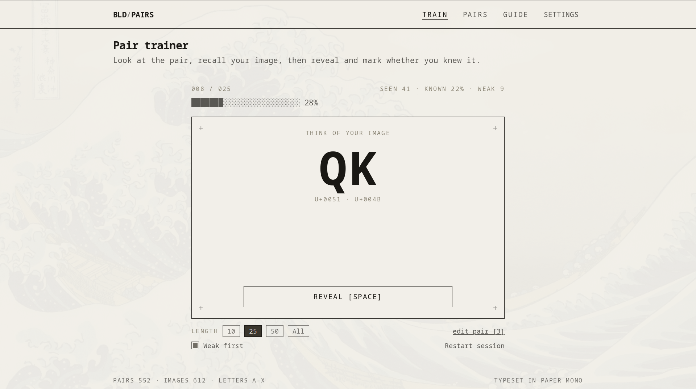
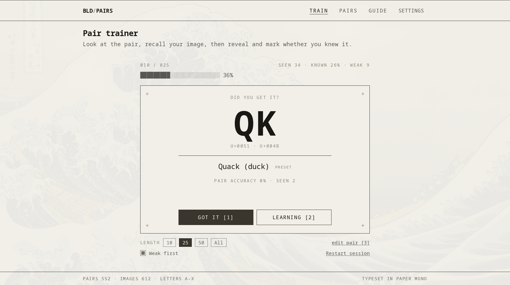
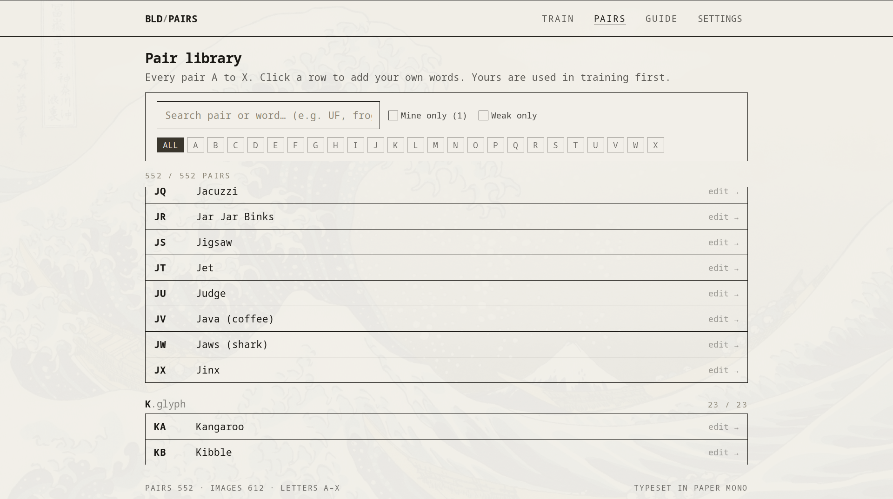

# bldtrainer

Flashcard trainer for 3x3 blindfolded letter pairs. A pair shows up, you think of your image, reveal, mark whether you knew it.




552 pairs, Speffz A-X. Ships with presets, or click any pair and write your own words. Pairs you keep missing come back first.



## Run it

```sh
npm install
npm run dev
```

Set `NEXT_PUBLIC_SITE_URL` to your domain before `npm run build`, otherwise canonical URLs and the sitemap point at the placeholder.

## Pairs

Edit `src/assets/pairs.txt`. One per line, `AB: word, alternate`. The app reads the file directly, nothing to regenerate.

## Notes

No account, no server. Custom words, progress, and settings live in localStorage. A background photo lives in IndexedDB on the same machine and is never exported. Settings has Export/Import JSON if you switch machines.
